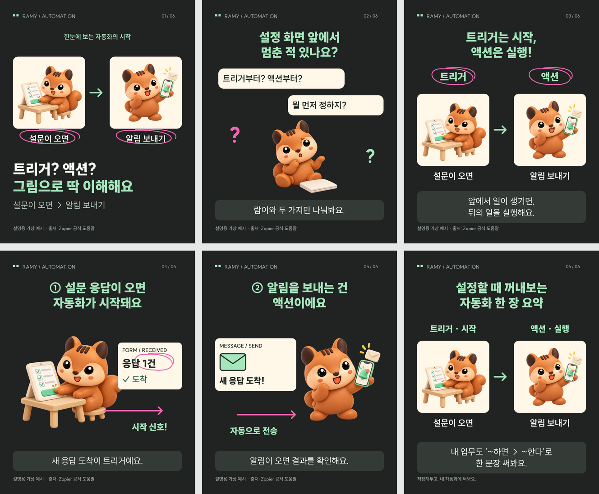

# My Harness — 허들링 실험

## 4차 싸이클 · 2차 실험: 이미지로 설명하는 카드뉴스

AI·자동화 개념을 람이와 이미지·도식으로 설명하는 카드뉴스 하네스입니다. 본문은 장면과 행동부터 설계하고 풀이를1~2줄로 줄이며, 실제 이미지를 보고 검수합니다.

- **[최종 카드뉴스6장과 다운로드](cardnews-final/README.md)**
- **[하네스 코드·사용법](cardnews-harness/README.md)** · [제작 순서](cardnews-harness/WORKFLOW.md)



이번 공개 범위는 최종 카드뉴스와 하네스 코드·사용법입니다. 개별 캐릭터 원본·이전 시안·상세 인터뷰·내부 작업 기록은 포함하지 않습니다. 아래 이전 실험 자료는 이 저장소에 이미 공개되어 있던 내용입니다.

현재 결과는 실험용 예시이며 디자인 완성도·다른 주제의 일관된 품질·실제 독자 반응은 추가 검증이 필요합니다.

---

## 이전 실험 — 허들링 디자인 작업 하네스

수작업 디자인 과정을 5단계 에이전트 역할, 운영진 승인 게이트, 읽기 전용 판정 스크립트로 구성한 로컬 하네스입니다.

- [실행 방법](harness/README.md)
- [서비스 요구사항](PRD.md) · [서비스 스토리](story-service.md)
- [실제 수작업 흐름](story-work.md) · [디자인 기준](design.md)
- [목적](harness-purpose.md) · [파이프라인](harness-pipeline.md)
- [오케스트레이터 적용 초안](docs/harness/R7-orchestrator-draft.md) · [검증 결과](docs/harness/R8-verification.md)

Python 3.10 이상이 필요하며 추가 Python 패키지는 없습니다.

```sh
python3 scripts/harness.py --help
python3 -m unittest discover -s tests -v
```

현재 범위는 구조화된 디자인 명세의 생성·승인·검토입니다. uibowl 수집, 실제 Figma 화면 생성과 픽셀 검사는 연결되지 않았습니다. Codex/Claude 실행에는 해당 CLI 설치와 인증이 필요합니다.

실행 기록 `runs/`, 개인 도구 설정, 로컬 OMA 설치 파일은 저장소에서 제외합니다. 기존 AGENTS.md와 CLAUDE.md의 OMA 블록은 로컬 개발 환경용이며, 하네스 CLI 자체는 OMA 없이 실행됩니다. 하네스용 추가 지침은 아직 R7 초안이며 채택 전입니다.
